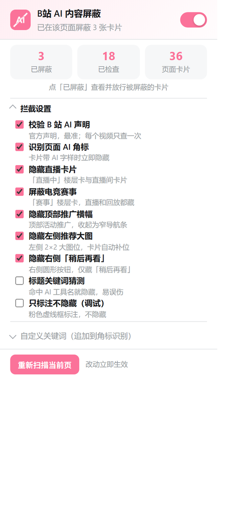

# B站 AI 内容屏蔽

一个 Chrome 扩展（Manifest V3）：在 B 站首页、搜索页、视频页推荐里，自动识别并隐藏
**带有「含AI生成内容」标注**的视频卡片，顺带屏蔽首页的直播卡片。

判定依据是 **B 站自己的内容声明数据**（`argue_info.argue_msg`），不是靠标题瞎猜。


<sub>同一页面、同一滚动位置：右图隐藏了 2 张带「含AI生成内容」标注的卡片和 2 张直播卡片，后面的卡片自动前移补位。</sub>

---

## 免责声明（个人自用）

- 本项目是一个**个人自用**的浏览器显示过滤器，只在本机浏览器里隐藏我自己屏幕上的整张卡片；
- **不修改** B 站任何数据、**不上传**任何浏览记录或账号信息，**不破解**接口鉴权，也不改动平台展示给其他人的内容；
- 接口调用做了限速、串行、7 天缓存（详见「请求量与风控」），不会高频请求；
- **不得**用于商业分发、批量采集、绕过平台规则或其它违反 B 站用户协议、相关法律法规的用途；
- 关键词猜测模式只是启发式粗筛，命中不代表视频真的是 AI 生成，请自行判断；
- 使用本扩展产生的任何后果由使用者自行承担，与 B 站及本项目作者无关。

如果 B 站不允许此类客户端过滤行为，请立即停止使用并卸载。

---

## 快速开始

1. 打开 Chrome，地址栏输入 `chrome://extensions/`；
2. 右上角打开 **开发者模式**；
3. 点 **加载已解压的扩展程序**，选择本项目文件夹（含 `manifest.json` 的这一层）；
4. 打开 <https://www.bilibili.com/index.html>，卡片会被自动过滤；
   安装前页面已经开着的话，刷新一次。

Edge / 360 等 Chromium 内核浏览器同理（`edge://extensions/`）。

---

## 日常怎么用

点工具栏上的粉色「AI」图标打开面板，图标上的数字 = 当前页屏蔽数量。

### 1. 看统计

- **已屏蔽**：当前页被隐藏的卡片数，**点这一格可以展开列表**；
- **已检查**：走接口确认过的视频数（说明接口在正常工作）；
- **页面卡片**：当前页识别到的卡片总数。

### 2. 预览与放行

点「已屏蔽」展开列表，每条都有封面缩略图、标题、UP 主：

| 按钮 | 作用 | 记录方式 |
| --- | --- | --- |
| **放行** | 只恢复这一张卡片，以后也不再屏蔽 | BV 号 / `live:<房间号>` |
| **UP主** | 恢复这个 UP 主名下的所有 AI 卡片 | 空间 mid |
| **清空放行记录** | 撤销全部放行，重新开始拦截 | 清空 `allowlist` |

放行记录存在 `chrome.storage.local` 的 `allowlist` 里：

```json
{ "keys": ["BV1xx411c7mD", "live:21144080"], "mids": ["392836434"] }
```

刷新页面、重启浏览器都会保留；点「清空放行记录」即可全部撤销。

### 3. 拦截设置

默认展开，九个开关（外加面板右上角的总开关）：

| 开关 | 默认 | 说明 |
| --- | --- | --- |
| 校验 B 站 AI 声明 | 开 | 走接口读官方声明，最准 |
| 识别页面 AI 角标 | 开 | 卡片上直接带 AI 字样时立刻隐藏，不等接口 |
| 隐藏直播卡片 | 开 | 首页「直播中」楼层卡、直播房间卡片一律隐藏 |
| 屏蔽电竞赛事 | 关 | 首页「赛事」楼层卡，直播和回放都藏 |
| 隐藏顶部推广横幅 | 关 | 主页顶部活动大横幅，收起成窄导航条 |
| 隐藏左侧推荐大图 | 关 | 首页左侧 2×2 的大图推荐位不显示，信息流自动补位 |
| 隐藏右侧稍后再看 | 关 | 只藏右下角圆形「稍后再看」按钮，换一换 / 刷新保留 |
| 标题关键词猜测 | 关 | 按标题/UP 主名粗筛，容易误伤，算法见下文 |
| 只标注不隐藏（调试） | 关 | 不隐藏，改用粉色虚线框 + 原因标注，用来核对判定 |

「自定义屏蔽关键词」会匹配**标题 / UP 主名 / 楼层卡标题**，逗号分隔，例如 `黄仁勋, 逸选`；命中即隐藏，优先级最高（高于直播、角标、声明）。

### 4. 更新扩展后

`chrome://extensions/` → 重新加载 → **刷新 B 站页面**（旧页面的内容脚本是旧上下文）。

---

## 判定原理

三路识别，按可靠性排序：

| 路径 | 依据 | 默认 |
| --- | --- | --- |
| **API 声明** | 卡片链接里的 BV 号 → `api.bilibili.com/x/web-interface/view` 的 `argue_info.argue_msg`（视频页那句「含AI生成内容」就是它渲染的） | 开 |
| **DOM 角标** | 卡片里出现 `argue` 组件或带 AI 字样的角标，同步隐藏 | 开 |
| **关键词猜测** | 标题 / UP 主名命中 AI 工具名，见下节 | 关 |

判定顺序（命中即停）：

1. 放行白名单（BV / 直播间 / UP 主 mid）；
2. 自定义屏蔽关键词（标题 / UP 主名 / 楼层标题）；
3. 直播卡片（如果开了「隐藏直播卡片」）；
4. 赛事卡片（如果开了「屏蔽电竞赛事」）；
5. DOM 角标文字；
6. 关键词猜测（如果开启）；
7. API 声明（异步，结果回来再隐藏）。

`含虚构演绎内容` 这类声明不会被误杀，只匹配 `AI` / `人工智能` / `AIGC` 一类文案。

### 标题关键词猜测的算法

用途：B 站没标注、但标题/UP 主名明显是 AI 生成内容时兜底。**默认关闭**，因为会误伤 AI 教程和 AI 新闻。

**第 1 步 取样**：取卡片标题（`.bili-video-card__info--tit`）和 UP 主名
（`.bili-video-card__info--author`），用空格拼成一个字符串。

**第 2 步 归一化**（`normForGuess`）：

- 全角字母数字转半角：`ＳＯＲＡ` → `SORA`
- 统一转小写：`SORA` → `sora`
- 连续空白折叠为一个空格

**第 3 步 关键词表**（`GUESS_KEYWORDS`）：

```
AI生成 / AIGC / AI绘画 / AI视频 / AI动画 / AI配音 / AI翻唱 / AI换脸 / AI创作 / AI MV
数字人 / 即梦 / 可灵 / 海螺 / Vidu / Sora / Veo / Midjourney / Stable Diffusion / ComfyUI
```

**第 4 步 匹配规则**（`hitKeyword`）：

- **纯英文关键词**（`sora`、`veo`、`comfyui`…）：按「词」匹配，前后不能紧贴英文字母；
  允许紧跟数字和中文，所以 `sora2`、`veo3`、`sora生成` 都算命中，`Soraka`、`video` 不算；
- **含中文的关键词**（`AI生成`、`即梦`、`可灵`…）：中文没有词边界，按子串匹配；
- 命中第一个关键词就返回（短路），卡片隐藏，原因写成「疑似 AI：<关键词>」。

伪代码：

```js
const blob = normForGuess(title + ' ' + author); // 全角转半角 + 小写 + 压缩空白

for (const kw of GUESS_KEYWORDS) {
  if (isAscii(kw)) {
    // 前后不能紧贴英文字母，数字/中文/标点都算边界
    if (new RegExp(`(^|[^a-z])${escape(kw)}([^a-z]|$)`).test(blob)) return kw;
  } else if (blob.includes(normForGuess(kw))) {
    return kw; // 中文子串
  }
}
```

**命中示例**：

| 标题 / UP 主 | 结果 | 原因 |
| --- | --- | --- |
| `Sora 生成的视频合集` | 命中 | 英文词边界 |
| `Soraka 辅助上分攻略` | 不命中 | `sora` 后面紧跟字母 `k` |
| `ＳＯＲＡ 全角测试` | 命中 | 全角转半角后命中 |
| `veo3 电影感测试` | 命中 | 允许数字后缀 |
| `video 剪辑教学` | 不命中 | `veo` 不在词边界 |
| `我用AI绘画做了个头像` | 命中 | 中文子串 |
| `ComfyUI 研习社`（UP 主） | 命中 | UP 主名也参与匹配 |

**误伤边界**：AI 教程、AI 资讯、AI 工具评测都会被命中；这是关键词模式的固有代价，所以默认关闭。
想更精准就改 `src/content.js` 里的 `GUESS_KEYWORDS`，或干脆只用 API 判定。

### 为什么不用「封面和标题毫不相干」这类判断

封面和标题对不上、画面诡异，确实是 AI 内容的常见特征，但纯前端拿不到画面语义
（封面只是一张图，没有可读的文本标签）。硬做只能靠乱猜，误杀率会高得没法用。
所以主路线是「B 站已经标注的，一律屏蔽」，关键词模式只作为可手动打开的兜底。

### 隐藏的是哪一层

- 首页：隐藏 `.feed-card`（整张卡片所在的格子），CSS Grid 自动补位，不留空洞；
- 首页直播：`.floor-single-card` 里带「直播中」/ `.living` / 房间链接的整卡隐藏；
- 首页赛事：`.floor-single-card` 角标（`.floor-title`）为「赛事」的整卡隐藏，需要打开「屏蔽电竞赛事」；
- 信息流末尾的**骨架占位**（B 站为下一批预置的灰色占位卡）临时隐藏；
  末尾的 `.load-more-anchor` 压成 1px 高（保留滚动加载触发点），
  避免隐藏卡片后整页变短、灰块被顶进视口看起来像布局坏了；
- 搜索页：隐藏 `.video-list` 的**直接子格**（`div.col_3.col_xl_1_7` 这类栅格类），
  而不是格子里的 `.bili-video-card`，藏对了格子后面的卡片才会前移补位；
- 竖屏 story 卡 / 视频页右侧小卡：各有对应包裹层。

### 为什么必须藏「格子」，不能只藏卡片

搜索结果页的列表是 `display: flex; flex-wrap: wrap`，每个格子是 `.video-list` 的直接子节点：

```html
<div class="video-list row">
  <div class="col_3 col_xs_1_5 col_md_2 col_xl_1_7 mb_x40">   <!-- 格子：宽 14.28%（1/7） -->
    <div class="bili-video-card">…</div>                       <!-- 卡片 -->
  </div>
</div>
```

flex 行默认 `align-items: stretch`：把卡片 `display: none` 之后，格子本身仍被拉满行高、
照样占着自己那一列，页面上就留下一个**空洞**——后面的卡片不会前移。
（1.7.1 及以前就是藏的这一层，所以搜索页会看到一块块空白。）

所以 `pickTarget()` 先爬到这个「和别的格子并排」的容器再藏：

1. 命中 `WRAPPERS`（`.feed-card` / `.video-list-item` / `.rank-item` …）直接用；
2. 否则往上爬，直到「父节点的兄弟都是**最多一张卡**的格子」，这一层就是格子；
   同层只要出现装着好几张卡的列表（比如视频页右侧 `.rec-list` 塞了 19 张），
   说明爬过头了，立刻收手，退回藏卡片本身；
3. 都不满足时退回老的「独占一格」启发式。

搜索页走第 2 条，藏的是 `div.col_3…` 这层，flex 行重排后卡片补位，一行 7 个位子重新排满。
判定的依据是结构而不是类名，B 站换栅格类名也照样能找到格子。


<sub>同一页、同一批被屏蔽的卡片（3 张直播 + 2 张 AI）：左 1.7.1 只藏卡片，格子还在，红框处是空洞；右 1.7.2 藏整格，后面的卡片前移补位。</sub>

另外三个**默认关闭**的布局开关（面板「拦截设置」里开）：

- **隐藏顶部推广横幅**：隐藏首页顶部活动横幅 `.bili-header__banner`，导航条改成白底深字，页面整体上移；只在 `.bili-header--large`（首页）生效，其它页面不受影响；
- **隐藏左侧推荐大图**：隐藏首页 2×2 的大图轮播位 `.recommended-swipe`，网格自动用卡片补位；同时把 B 站给卡片打的 inline `margin-top` 清零（那些 margin 原本是对齐大图两行用的，留着会造成行错位）；
- **隐藏右侧稍后再看**：只隐藏右下角的 `.watchlater-pip-button`（稍后再看），
  「换一换」和「刷新内容」保持原样；该按钮是悬浮控件，藏掉不占布局、不影响信息流。

三个开关只给 `<html>` 加一个 class（`bbai-hide-banner` / `bbai-hide-hero` / `bbai-hide-side`），
不覆盖 B 站原有样式，关掉立即恢复。

隐藏大图后页面会变短（少了一整块 2×2 区域），向下滚动 B 站会继续加载下一批，
属于正常现象；骨架占位同样会被临时隐藏，不会露出灰色块。

滚动到底时 B 站照常加载下一批，插件会继续过滤。若 B 站改版连结构也换了，
`pickTarget()` 会退化成「向上找独占一个格子的父节点」，一般也能藏对。

---

## 面板截图

默认态（设置展开、列表收起）：



点「已屏蔽」展开预览列表（设置自动收起，弹窗高度不超过 600px）：


调试模式（只标注不隐藏）：


---

## 请求量与风控

- 只对**快要进入视口**的卡片发请求（视口外 500px 预取），首屏通常十几张；
- 请求串行，每两次至少间隔 150ms；
- 结果按 BV 号缓存 **7 天**（`chrome.storage.local`，上限 5000 条），同一视频不重复请求；
- 遇到风控（`-412` / `-352` / `-509`）冷却 60 秒，之后自动重试。

正常浏览基本感觉不到额外开销，二次访问同一批视频几乎零请求。

---

## 常见问题

**刷新页面后卡片闪一下才消失？**
是。API 结果回来之前卡片已经渲染出来了。DOM 角标那一路是同步的，能挡住一部分。

**有的 AI 视频没被屏蔽？**
只有 B 站**打了标注**的才会被屏蔽。UP 主没声明、B 站也没识别的不会命中，这是准确率的代价。
需要更激进就打开「标题关键词猜测」。

**隐藏之后页面变短、底部空了一块？**
正常。被过滤的卡片不再占位，页面自然变短；往下滚会继续加载下一批，并继续过滤。

**搜索页被屏蔽的卡片原地留了个洞，后面的卡片不往前挪？**
1.7.2 起已修好：以前藏的是格子里的 `.bili-video-card`，而格子（`div.col_3.col_xl_1_7`）本身还被 flex 行的
`align-items: stretch` 撑满、占着那一列，所以会留洞。现在按结构找到格子再藏，后面的卡片正常补位。
如果还看到洞，多半是 B 站又改了结构——到 `chrome://extensions` 重新加载并刷新页面，再把页面结构发出来。

**能不能干脆劫持搜索接口，把 AI 结果过滤掉、或者改 pageSize 多拿几条？**
做不到，也没必要：

- 搜索结果页是**服务端直出**的：首屏 42 张卡片直接写在 HTML 里，整页一个搜索请求都没有；
  翻页是 `?page=2` 整页跳转 + 服务端渲染，前端拦不到数据；
- `x/web-interface/wbi/search/type` 只有 `page` / `page_size` / `order` 这类参数，**没有任何过滤 AI 的入参**；
  调大 `page_size` 只是多返回几条，被判定掉的照样留空，还是得自己补数；
- 真要过滤就得带 wbi 签名重发请求、再把数量补足，等于把 B 站的分页逻辑重写一遍，
  签名和风控一变就失效——不如把「格子」藏对，让 CSS 自己补位，代价是每页少几张卡片。

**放行了卡片 / UP 主，怎么撤销？**
面板「被屏蔽的卡片」右上角「清空放行记录」。
也可以到 `chrome://extensions` → 该扩展「检查视图」→ Application → Extension storage，删掉 `allowlist`。

**会不会误杀正经 AI 教程？**
默认不会。「校验 B 站 AI 声明」看的是视频**是否由 AI 生成**，讲 AI 的教程只要 UP 主没声明就不会被屏蔽。
只有手动打开「标题关键词猜测」才可能误伤。

**面板显示「当前页面不是 B 站」、数字全是 0？**
1.0.0 的老 bug（靠 `tab.url` 判断，而扩展没有 `tabs` 权限）。1.0.1 起已改为直接问内容脚本，
请在 `chrome://extensions/` 重新加载后刷新页面。

---

## 目录结构

```
bilibili-ai-blocker/
├── manifest.json          # MV3 清单
├── icons/                 # 16 / 32 / 48 / 128 图标
├── docs/                  # README 截图（compare / search-fill / popup / debug）
└── src/
    ├── content.js         # 卡片识别、找格位、隐藏、放行、MutationObserver
    ├── content.css        # .bbai-hidden / .bbai-marked / 骨架隐藏样式
    ├── background.js      # 调 B 站接口、缓存、节流、角标数字
    ├── popup.html         # 设置面板 + 屏蔽预览
    ├── popup.css
    └── popup.js
```

## 想自己改

- **加卡片类型**：`content.js` 顶部的 `CARD_SEL`（要检查的节点）、`WRAPPERS`（已知的格位容器）；
- **改隐藏层级**：`pickTarget()`——决定「藏哪一层」才能让布局补位，逻辑见上文「为什么必须藏格子」；
- **改关键词**：`GUESS_KEYWORDS`（猜测模式），或面板里的「自定义关键词」（角标识别）；
- **改请求策略**：`background.js` 里的 `REQUEST_GAP_MS` / `CACHE_TTL` / `CACHE_MAX`；
- **清缓存**：DevTools → Application → Extension storage，删 `aiCache`；
- **改匹配范围**：`manifest.json` 的 `content_scripts.matches`。

## 版本

- 1.7.2：修复搜索结果页屏蔽后留下空洞（以前只藏卡片，flex 格子仍占位）——改为按结构找到「格子」再藏，后面的卡片正常前移补位；视频页右侧推荐不会误藏整块列表
- 1.7.1：修复标签页关闭时角标 API 的未处理 Promise 拒绝（扩展「错误」页不再刷 `No tab with id`）
- 1.7.0：自定义关键词改为直接匹配标题 / UP 主名 / 楼层标题（之前只匹配 AI 角标，容易让人以为没生效）
- 1.6.0：新增「屏蔽电竞赛事」开关（默认关闭），隐藏「赛事」楼层卡
- 1.5.0：新增「隐藏顶部推广横幅」开关（默认关闭）
- 1.4.2：修复隐藏左侧大图后卡片行错位（清除 B 站遗留的 inline margin-top）
- 1.4.1：右侧按钮开关收窄为只隐藏「稍后再看」，「换一换 / 刷新」保留
- 1.4.0：新增两个可选布局开关 —— 隐藏左侧 2×2 大图推荐位、隐藏右侧悬浮按钮（默认关闭）
- 1.3.2：关键词猜测算法改为「归一化 + 英文词边界 + 中文子串」，修正 `veo3`、全角、`Soraka` 误判
- 1.3.1：面板默认展开设置、列表收起，点「已屏蔽」展开；列表加高；折叠箭头换成细线 chevron
- 1.3.0：新增屏蔽预览、单条放行、按 UP 主放行、清空放行记录
- 1.2.0：隐藏直播卡片；处理信息流末尾骨架占位
- 1.0.1：修复面板误判「不是 B 站」


